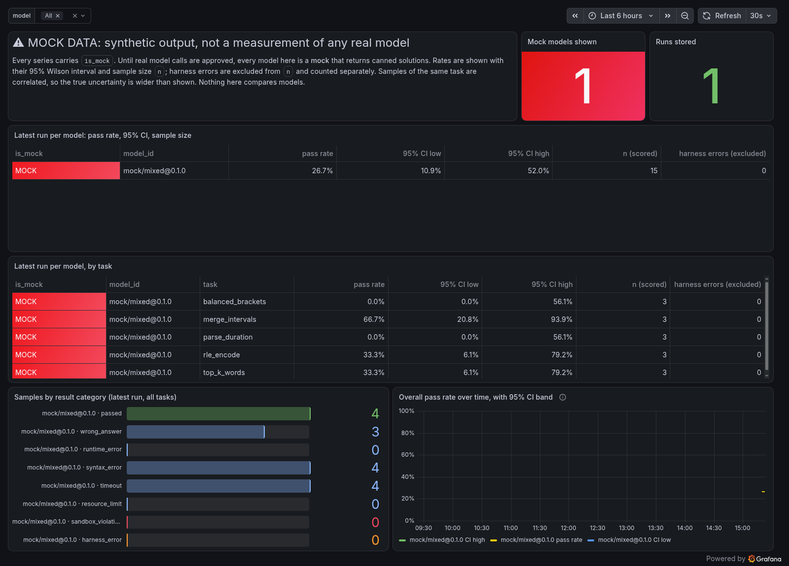

# LLM-coding-eval-harness

A harness that runs model-generated code against test suites inside a locked-down sandbox and
records reproducible, categorized results. The goal is to package it with Docker, provision it with
Terraform, deploy it through GitHub Actions, and monitor pass rates with Grafana. Those parts are
built milestone by milestone; see [docs/PLAN.md](docs/PLAN.md).

> **Status: Milestones 1–4 (core harness; results, metrics, read-only API; images and CI; local Kubernetes with Prometheus and Grafana).** Only a **mock model** exists. Every result it produces
> is synthetic and labeled `MOCK`. It is not a measurement of any real model.

## Quick start

Requirements: Linux or macOS, Docker, [uv](https://docs.astral.sh/uv/).

```bash
make install          # .venv with the package + pytest + ruff
make sandbox-image    # build evalharness-sandbox:0.2.0
uv run evalharness list-tasks
uv run evalharness validate                       # every task: reference passes, incorrect fails
uv run evalharness run --model mock-reference     # end to end; writes runs/<run_id>.json
uv run evalharness run --model mock-mixed --samples 3 --seed 1   # prints pass rates + 95% CIs
uv run evalharness runs                         # stored runs (results/evalharness.sqlite)
uv run evalharness report <run_id>              # the report again; --json for machines
uv run evalharness serve                        # read-only API at http://127.0.0.1:8000/docs
make test             # 124 tests, including adversarial sandbox tests (1 is Kubernetes-only)
make test-gvisor      # the same suite with every sandbox under gVisor (if installed)
make ci               # everything CI runs: lint, workflow lint, both images, tests, smoke test
```

**Service image** (read-only API; never runs model code):

```bash
make service-image
docker run --rm -p 127.0.0.1:8000:8000 -v evalharness-data:/data evalharness-service:0.4.0
```

**Local Kubernetes + dashboard** (kind; nothing leaves your laptop, needs `kind` and `kubectl`):

```bash
make deploy      # kind cluster, all images loaded, API + Prometheus + Grafana + sandbox namespace
make k8s-eval    # one MOCK evaluation as a Job; every sample runs in its own locked-down pod
make dashboard   # Grafana at http://127.0.0.1:3000 (anonymous, read-only)
make test-k8s    # the adversarial sandbox suite, with every sample in a kind pod
make cluster-down
```



*Screenshot of mock data: synthetic output from `mock-mixed`, not a model result.* How the
Kubernetes sandbox works and where it is weaker than Docker: D20.

**CI** (`.github/workflows/ci.yml`) runs lint, the full test suite including the adversarial
sandbox tests, and both image builds plus a smoke test on every push. It uses no secrets and
deploys nothing.

The harness uses whichever Docker daemon your CLI points at. If `docker info` fails because your
active context isn't running (for example Docker Desktop is stopped), switch with
`docker context use default` or set `DOCKER_CONTEXT` for one command.

**Stronger isolation (optional):** with [gVisor](https://gvisor.dev) installed and registered
as Docker's `runsc` runtime, pass `--runtime runsc` (or set `EVALHARNESS_SANDBOX_RUNTIME=runsc`).
The untrusted code then talks to gVisor's user-space kernel instead of the host kernel. That
costs about 0.5 s more per sample. Each result records which runtime was used. See D13.

## Docs
- [docs/PLAN.md](docs/PLAN.md): architecture and milestones
- [docs/DECISIONS.md](docs/DECISIONS.md): decisions, alternatives, and tradeoffs
- [docs/LEARNING.md](docs/LEARNING.md): concepts explained
- [docs/INTERVIEW_NOTES.md](docs/INTERVIEW_NOTES.md): problems hit and how they were solved
